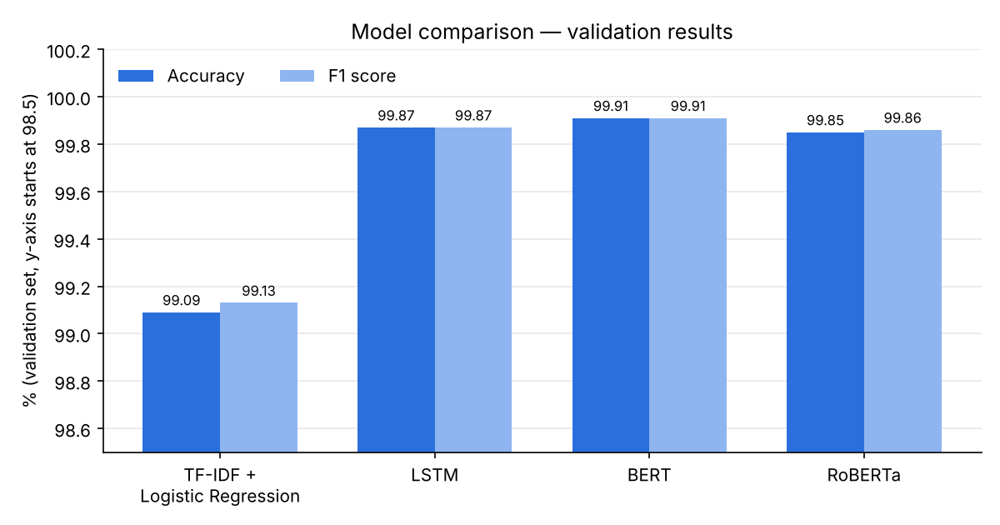
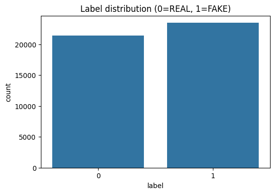
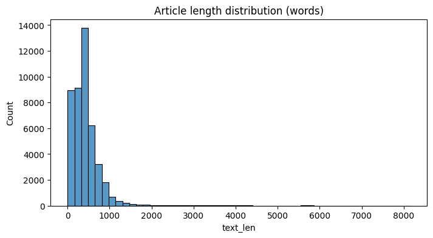
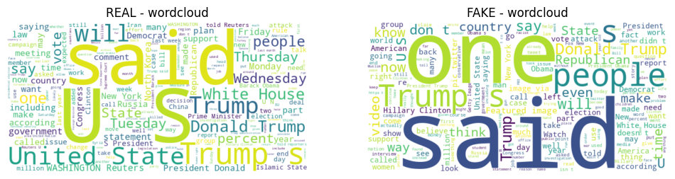
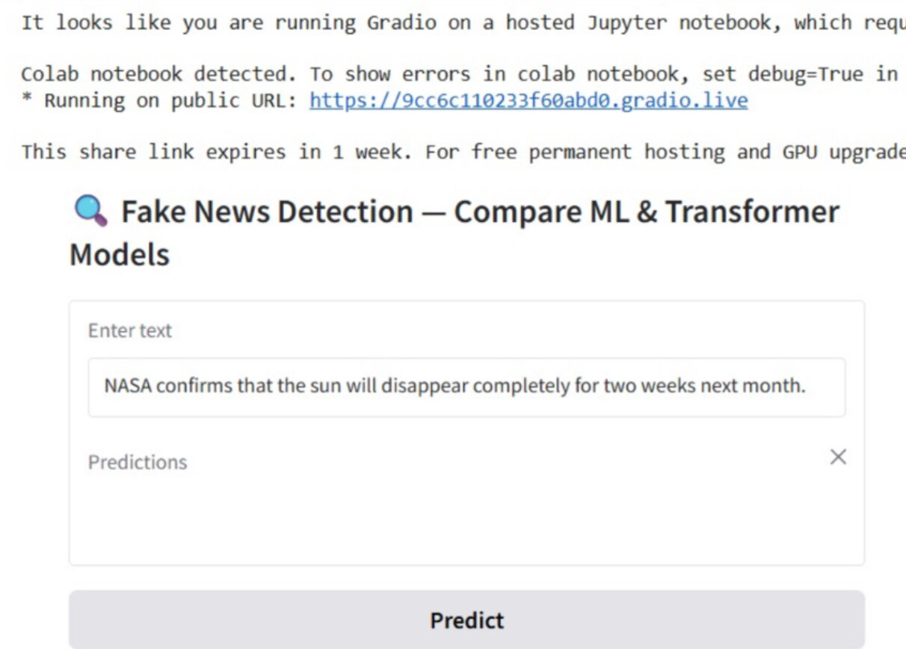

# 📰 Fake News Detection using Machine Learning & Transformers

Classifying news articles as **REAL** or **FAKE** with four NLP models, from a classical baseline to fine-tuned transformers: **TF-IDF + Logistic Regression**, **LSTM**, **BERT** and **RoBERTa**. A **Gradio** web interface lets you paste any news text and compare all four predictions side by side.

> Data Science course project (December 2025) by **Hams Aljohani** & **Randa**, supervised by **Dr. Passent Elkafrawy**.



---

## 🏆 Results (validation set, 6,735 articles)

| Model | Accuracy | Precision | Recall | F1 score | Errors |
|---|---|---|---|---|---|
| TF-IDF + Logistic Regression | 99.09% | 99.46% | 98.81% | 99.13% | 61 |
| LSTM (Bidirectional) | 99.87% | 99.83% | 99.91% | 99.87% | 9 |
| **BERT** (bert-base-uncased) | **99.91%** | **99.89%** | **99.94%** | **99.91%** | **6** |
| RoBERTa (roberta-base) | 99.85% | 99.83% | 99.89% | 99.86% | 10 |

**BERT performed best**, with only 6 wrong predictions out of 6,735. The classic TF-IDF baseline still reached 99%, but the context-aware deep models cut its errors by about 84–90%.

---

## 📊 Dataset

[Fake and Real News Dataset (Kaggle)](https://www.kaggle.com/datasets/clmentbisaillon/fake-and-real-news-dataset): **44,898** articles.

| File | Articles | Label |
|---|---|---|
| `Fake.csv` | 23,481 | 1 = FAKE |
| `True.csv` | 21,417 | 0 = REAL |

Split **70 / 15 / 15** (train 31,428 · validation 6,735 · test 6,735), stratified by label.

| Label distribution | Article length | Word clouds |
|---|---|---|
|  |  |  |

> The CSV files are not included because they are too large for GitHub. See [`data/README.md`](data/README.md) to download them.

---

## ⚙️ Pipeline

1. **Pre-processing**: merge title + text, lowercase, remove URLs, punctuation and NLTK stop-words.
2. **TF-IDF + Logistic Regression**: 20,000 uni/bi-gram features, used as the baseline.
3. **LSTM**: Keras embedding (128-d) + Bidirectional LSTM, 300-token sequences, 3 epochs.
4. **BERT & RoBERTa**: fine-tuned with Hugging Face Transformers (TensorFlow), max length 256, batch size 8, 2 epochs, learning rate 2e-5 with warm-up.
5. **Evaluation**: accuracy, precision, recall, F1 and confusion matrix for every model.
6. **Interface**: a Gradio app that runs the input through all four models.



---

## 🛠️ Tech Stack

Python · pandas · NumPy · scikit-learn · NLTK · TensorFlow / Keras · Hugging Face Transformers · Gradio · Matplotlib · Seaborn · WordCloud · Google Colab (GPU)

---

## 📁 Project Structure

```
Fake-News-Detection-NLP/
├── notebooks/
│   └── Fake_News_Detection.ipynb   # Full pipeline: EDA → models → evaluation → Gradio app
├── data/
│   └── README.md                   # Where to download Fake.csv / True.csv
├── docs/
│   ├── Final_Research_Paper.pdf    # Literature review, methodology, results, discussion
│   ├── Presentation.pdf / .pptx
│   └── images/                     # Charts and interface screenshot
├── requirements.txt
└── README.md
```

---

## 🚀 How to Run

The notebook was built for **Google Colab** with a GPU. BERT and RoBERTa each took about 30+ minutes per epoch on a Colab GPU.

1. Download `Fake.csv` and `True.csv` (see [`data/README.md`](data/README.md)).
2. Open `notebooks/Fake_News_Detection.ipynb` in Colab and switch the runtime to **GPU**.
3. Upload the CSVs to your Google Drive (the notebook reads `/content/drive/MyDrive/Fake.csv` and `True.csv`), or change those paths.
4. Run all cells. The last cells launch the Gradio interface with a public link.

To run locally instead:
```bash
pip install -r requirements.txt
jupyter notebook notebooks/Fake_News_Detection.ipynb
```

---

## 📝 Notes & Future Work

- The scores are very high on this dataset. Its real and fake articles come from different sources with different writing styles, so the models partly learn those source cues. Testing on news from other sources would show how well they generalize.
- Next steps: evaluate on the held-out test set and on other datasets (e.g. LIAR, FakeNewsNet), add explainability (attention maps, LIME/SHAP), and deploy the Gradio app on Hugging Face Spaces.

📄 [Research paper](docs/Final_Research_Paper.pdf) · 🎞️ [Presentation](docs/Presentation.pdf)

---

## 👩‍💻 Authors

- **Hams Aljohani**
- **Randa**

Supervisor: Dr. Passent Elkafrawy
